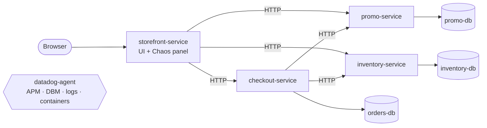

# ShopLite: a Datadog + Bits AI microservices sandbox

Four Node.js microservices and three Postgres databases, run with Docker Compose and fully
instrumented for Datadog: APM with distributed tracing, Database Monitoring (DBM), container
metrics and logs, Error Tracking and Source Code Integration. A **Chaos & Crash Testing
Panel** in the UI breaks things on purpose so you can watch Datadog alert, **Bits AI SRE**
find the root cause, and **Bits AI Dev Agent / Bits Code** open a fix PR.

Setup walkthrough for Datadog and Bits AI: **[docs/BITS_AI_SETUP.md](docs/BITS_AI_SETUP.md)**

## Architecture



| Folder | Container / `DD_SERVICE` | Database | What it does |
| --- | --- | --- | --- |
| [`services/storefront`](services/storefront) | `storefront-service` | none | Web UI, catalog view, Chaos panel. HTTP only. |
| [`services/checkout`](services/checkout) | `checkout-service` | `orders-db` | Prices the cart, calls promo + inventory, saves the order |
| [`services/promo`](services/promo) | `promo-service` | `promo-db` | Validates promo codes, calculates discounts |
| [`services/inventory`](services/inventory) | `inventory-service` | `inventory-db` | Catalog and stock reservations |

Every service container carries Unified Service Tagging (`DD_SERVICE`, `DD_ENV=staging`,
`DD_VERSION`) and `DD_GIT_REPOSITORY_URL` / `DD_GIT_COMMIT_SHA`, so a stack frame in Datadog
opens `services/<name>/src/<file>.js` at the right line on GitHub. The code sits at
`/app/services/<name>` in each image, the same path as in the repo.

## Start the stack

### In GitHub Codespaces (nothing installed locally)

1. Add `DD_API_KEY` and `DD_SITE` as Codespaces secrets for this repo
   ([details](docs/BITS_AI_SETUP.md#2-add-your-datadog-api-key-as-a-codespaces-secret)).
2. **Code → Codespaces → Create codespace.** The Codespace needs 4 cores / 8 GB.
   On start, `.devcontainer/start-agent.sh` runs `./scripts/stack.sh up`.
3. Open the forwarded port **3000**.

### With Docker on your own machine

```bash
cp .env.example .env          # put DD_API_KEY (and DD_SITE) in .env
```

```bash
./scripts/stack.sh up         # builds images, starts 4 services + 3 databases + Datadog Agent
```

Then open <http://localhost:3000>. Without `DD_API_KEY` the script starts everything except
the Agent. Other commands: `./scripts/stack.sh logs [service]`, `down`, `reset` (deletes the
database volumes to get fresh seed data).

Commit and push before starting so the `DD_GIT_COMMIT_SHA` stamped on the containers exists
on GitHub.

### Without Docker (UI and logic work only)

```bash
npm install
```

```bash
npm run dev                   # all 4 services in one process, in-memory Postgres, no Datadog
```

Storefront on <http://localhost:3000>. The chaos buttons work. "Kill promo-service" closes
its port for 8 seconds instead of exiting a container.

## The Chaos & Crash Testing Panel

All four buttons are on the storefront page. The **Service status** bar at the top polls
every service's `/health` every 2 seconds and logs each down/up change in **Activity**.

| # | Button | What breaks | Expected response |
| --- | --- | --- | --- |
| 1 | **[App Cross-Service Bug]** Trigger Cascading Promo Null Error | `LEGACY_VIP` goes storefront → checkout → promo. promo-service returns `200 OK` with `discount: null` (all legacy tiers expired); checkout-service reads `discount.amountCents` → `TypeError` | `500` from checkout |
| 2 | **[App Process Crash]** Kill Promo Service Process | promo-service fills memory past its 256 MB `mem_limit` → OOM-kill (or `process.exit(1)`) → Docker restarts it | `202`, then promo shows **down** for a few seconds, then **up** |
| 3 | **[Database Code Bug]** Trigger Inventory DB Schema / Query Crash | An audited reservation runs `UPDATE reservations SET reserved_audit_flag = $2::boolean` (no such column, and `'pending-review'` isn't a boolean) | `500` from inventory |
| 4 | **[Database Resource Crash]** Exhaust Orders DB Connections & Row Lock | checkout-service holds every pool connection in open transactions with `SELECT … FOR UPDATE` on the order counter | `202`; checkout shows **degraded**; orders stall ~3 s then fail with connection timeouts until the hold ends |

Buttons 1 and 3 are **real bugs** on code paths customers can hit: `LEGACY_VIP` is a valid
code, and any order of $500 or more requests an audited reservation. They are what Bits AI
should fix. Buttons 2 and 4 are deliberate fault injection, not bugs. All chaos endpoints
exist only when `CHAOS_ENABLED=true` (the Compose default).

For alert thresholds, use **Trigger ×20** on buttons 1 and 3, or sustained traffic:

```bash
npm run traffic -- http://localhost:3000 30    # 30% of orders use LEGACY_VIP
```

## Verify the telemetry in Datadog

Filter everything by `env:staging`. Import the monitors in [`datadog/monitors/`](datadog/monitors)
(**Monitors → New Monitor → Import from JSON**).

**After any request:** in **APM → Service Catalog / Service Map** you should see
`storefront-service`, `checkout-service`, `promo-service`, `inventory-service` and their
`postgres` dependencies. Open a trace for `POST /api/checkout`: it spans storefront → checkout
→ promo + inventory → the SQL queries.

**1. Cascading promo null error**
- **Error Tracking:** `TypeError: Cannot read properties of null (reading 'amountCents')` in
  `services/checkout/src/orders.js` (`placeOrder`), service `checkout-service`.
- **The trace:** the `promo-service` span for `POST /promotions/validate` is a **200**. Its
  response is the bad data. The cause is in `services/promo/src/promotions.js`
  (`evaluateLegacyRules` returns `null`), not in checkout.
- **Bits AI SRE:** the `[shoplite] checkout-service 5xx errors` monitor alerts. The
  investigation should follow the trace downstream and name promo-service as the root cause.

**2. promo-service crash**
- **Infrastructure → Containers:** the `promo-service` container restarts, with exit code
  137 / OOMKilled (or 1). The `container.restarts` metric goes up and the
  `[shoplite] promo-service container restarted` monitor fires.
- **Logs:** `service:promo-service` shows the `chaos: … allocating memory` fatal line right
  before the restart.
- **APM:** storefront and inventory keep serving. Checkouts with a promo code return 503
  `promo-service is unavailable` for a few seconds; checkouts without one still return 201.

**3. Inventory DB query crash**
- **Error Tracking:** `DatabaseError: column "reserved_audit_flag" of relation "reservations"
  does not exist` (SQLSTATE `42703`), with the stack in `services/inventory/src/inventory.js`
  (`flagForAudit`). That's what Bits Code uses to open a fix PR.
- **DBM → inventory-db:** the failing `UPDATE reservations …` statement, linked to the
  `inventory-service` trace (`DD_DBM_PROPAGATION_MODE=full`).

**4. Orders DB connection & lock exhaustion**
- **DBM → orders-db:** blocking queries and lock waits on `order_sequence`, sessions *idle in
  transaction*, and a spike in active connections.
- **APM:** `checkout-service` `POST /orders` latency spikes; errors with
  `timeout exceeded when trying to connect`. The `[shoplite] checkout-service order latency
  high` monitor fires. It recovers when the hold ends (45 s by default).

Then let Bits AI fix bugs 1 and 3: [docs/BITS_AI_SETUP.md](docs/BITS_AI_SETUP.md#7-let-bits-ai-fix-it).
The rules a fix PR must follow are in [`AGENTS.md`](AGENTS.md).

## Tests and validation

```bash
npm test             # every service's unit + HTTP tests (real Postgres SQL via PGlite)
```

```bash
npm run validate     # replays the incidents through all 4 services
```

`npm run validate` **fails on main on purpose**: the `LEGACY_VIP` scenario (expects 400) and
the high-value order scenario (expects 201) stay red until bugs 1 and 3 are fixed. CI runs
both commands and builds every Docker image on each PR.

## Repo layout

| Path | What |
| --- | --- |
| `services/<name>/` | One microservice: `src/`, `test/`, `db/` (schema + seed), `Dockerfile`, `README.md` with its **Incident & Fix Log** |
| `docker-compose.yml` | Services, databases, Datadog Agent (APM, DBM, logs, container metrics) |
| `datadog/postgres/` | Creates the `datadog` DBM user in each database on first start |
| `datadog/monitors/` | Importable monitors |
| `scripts/stack.sh` | Start/stop the Compose stack and stamp `DD_GIT_COMMIT_SHA` |
| `scripts/validate.js` | Incident replay (`npm run validate`) |
| `scripts/dev.js`, `scripts/lib/local-stack.js` | Docker-free local stack (`npm run dev`) |
| `scripts/traffic.js` | Background traffic generator |
| `test-support/pglite.js` | In-memory Postgres for tests |
| `.devcontainer/` | Codespaces: Node 20 + Docker, starts the stack |
| `AGENTS.md` | What a Bits AI fix PR must include |
| `docs/` | Runbook, Bits AI setup, past incidents |

## Notes

- Uses `dd-trace` 5.x because the services run Node 20. dd-trace 6 needs Node 22+.
- Logs are JSON on stdout. The Agent collects them from the containers, and each line
  carries `dd.trace_id` for trace ↔ log correlation.
- Database passwords in `.env.example` are sandbox defaults. The databases aren't published
  outside the Compose network.
